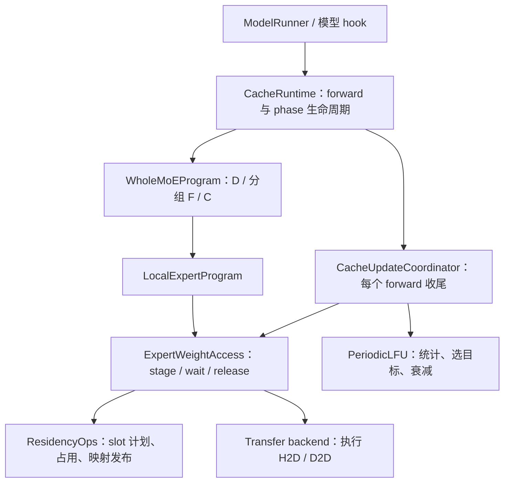

# MoE Cache 与 H2D 新接口合并适配设计

日期：2026-10-21
目标分支：`wanerlee/sglang:codex/moe-offload-dev`
状态：**已完成本地代码合并与 cache/框架调用方适配，117 项 CPU UT 通过。真实 NPU 后端与模型绑定仍待联调。**

## 1. 基线与目标

| 项目 | 核对版本 |
| --- | --- |
| 我方分支 | `4ec75ade79bd1de51aad59a41020dd662fde6cdd` |
| 同事分支 | `pachi-33/sglang:moe-offload-proto-v1`，`59cbb5d226c604b8ddc3876729ca009e7403614a` |
| 共同基线 | `5b13541370f4b3f4746ea4b88054801b6a278c81` |

实现前已再次 fetch，同事分支仍为上述 `59cbb5d`。以下保留原设计决策，实际结果见文末。

依据包括同事的 [H2D 设计 v0.4](https://github.com/pachi-33/sglang/blob/59cbb5d226c604b8ddc3876729ca009e7403614a/python/sglang/srt/offloading/moe/moe-h2d-design.zh-CN.md)、[执行协调代码](https://github.com/pachi-33/sglang/blob/59cbb5d226c604b8ddc3876729ca009e7403614a/python/sglang/srt/offloading/moe/execution.py)、[Program 实现](https://github.com/pachi-33/sglang/blob/59cbb5d226c604b8ddc3876729ca009e7403614a/python/sglang/srt/offloading/moe/programs.py)，以及我方 [Cache 总体设计](CACHE_DESIGN.zh-CN.md)、[LFU 设计](LFU_DESIGN.zh-CN.md)和 [H2D 交接表](CACHE_RUNTIME_HANDOFF.zh-CN.md)。

目标是保留现有 LFU、batch 计数、初始化和快照恢复，将执行链统一接到同事的新接口。我们负责 cache 和框架适配；同事负责真实传输后端、prefill 提交线程及流水调度。双方通过 `ResidencyOps`、`WholeMoEProgram` 及其公共数据结构协作。

本设计完成后，原 Cache 总体设计和交接表中关于旧接口的描述需同步更新；LFU 算法规则不变。这里只规定基本功能需要的适配，不增加重试系统、第二套缓存调度器或生产环境 eager 降级路径。

## 2. 保持不变的 Cache 行为

| 事项 | 合并后的行为 |
| --- | --- |
| 初始化 | 每个 EP rank 对自己可卸载的 `(layer, expert)` 按离线频次排序，装入前 K 个专家；在线 usage 从 0 开始。 |
| 在线计数 | 每个有效的本地 token-expert assignment 加 1；命中和 miss 都统计。padding 不统计。 |
| 调整周期 | 每 4 次有效的目标模型 decode forward 调整一次。prefill、全局空步、warmup、capture 不推进周期。 |
| 冷热配对 | **同一层内**，最热的非驻留专家与最冷的驻留专家配对。 |
| 门槛 | 候选 `usage >= 2`，且 `candidate_usage - victim_usage >= 1.5`；1.5 是差值，不是倍数。 |
| 数量限制 | 所有层的合格配对按热度差排序，每个 rank 每轮最多换入 96 个专家。 |
| 遗忘 | 每到调整轮，选择完成后所有 usage 乘 0.7；即使没有合格替换也衰减。 |
| miss | 只为本次计算加载到 execution bank；不会立即加入热池。 |
| 映射发布 | 新专家整个权重 bundle 搬完后再发布有效映射。 |
| Prefill | 保存 decode 元数据、借用热池空间、流式加载本 rank 的本层专家，返回 decode 前按原 slot 回填。 |

这里的 K 是热池容量，不能与同事 prefill 文档中首个计算分组的 K 混为一谈。

初始化允许跨层竞争热池容量，后续层内一换一保持各层驻留数量。某层初始分配为 0 时仍可通过 miss 执行，但本策略不会主动为它增加驻留名额。此次不改成全局冷热配对。

原需求提到 verify；当前框架仍拒绝投机解码，本次不解除该限制，也不宣称已经支持 verify。后续接入时再按有效 assignment 统计，并按完整目标模型 forward 推进周期。

## 3. 责任与调用边界



| 模块 | 我方工作 | 同事提供/负责 |
| --- | --- | --- |
| `PeriodicLFU`、`CacheMetadataAdapter` | usage、计数、周期、目标集合、快照 | 不参与缓存决策 |
| `TensorResidencyOps` | 生成计划、保护读者、维护热池和执行区映射、返回发布完成票据 | 真实权重布局、bank 视图和地址绑定 |
| `CacheRuntime`、模型/ModelRunner hook | phase 切换、上下文、Program 安装、forward 完成、图生命周期 | 真实设备能力及原生模型 backend 的绑定实现 |
| `ExpertWeightAccess` | 采用同事现有实现，统一调用入口 | 保持公共执行契约；不在 transfer 层实现 LFU |
| `WholeMoEProgram` | 安装公共 Program，接真实 dispatch 布局和 native F | prefill pipeline 实现、动态分组和提交线程 |
| transferOps | 依约提交计划、等待票据，不调用底层驱动 API | ACL/MemFabric 等后端、H2D/D2D、事件与地址转换 |

“通过 hook 约束 H2D”表示框架只在明确的生命周期入口进入卸载流程，不表示每次物理搬运都发生在层开始 hook。decode 的当前 wave 需求在 dispatch 后才确定，实际搬运由 Program 内的 `ExpertWeightAccess.stage()` 发起。

## 4. 不能只做文本合并的地方

| 当前我方实现 | 同事新接口 | 必须做的适配 |
| --- | --- | --- |
| `resolve_execution(local_demand)` 返回 `DeviceCopyPlan` | 接收 `ExecutionRequest`，返回 `ExecutionReservation` | 携带 phase、wave、bindings、依赖和 reservation 状态 |
| `publish_execution(ticket, context)` 无返回值 | 接收 reservation，返回 `TransferTicket` | 票据必须覆盖执行区映射发布 |
| 缺少 `finish_execution` | F 读完后归还 reservation | 记录最终读依赖，禁止提前复用 bank |
| 私有 `CacheUpdatePlan` | 公共 `UpdatePlan` | 删除重复外层类型，将 slot 元数据放到 `state` |
| `commit_update` 无返回值 | 返回发布票据 | copy 完成与映射发布完成分开表达 |
| `CacheLocalExpertProgram` 自行组织搬运 | `DecodeLocalExpertProgram` + `ExpertWeightAccess` | 删除重复搬运链，保留路由转换/统计逻辑 |
| native F 接收 wave，直接返回 output | 接收 bindings，返回 `LocalExecution` | 返回覆盖所有权重读流的 `read_done` |
| `CacheRuntime.emit_layer_start` 为空 | prefill 调用 `prefill_program.layer_start` | 使用公共 hook 行为 |
| metadata 的 `finish_step` 自行统计与衰减 | 新 `CacheUpdateCoordinator` 负责统计、选择和执行替换 | 合并成一个收尾入口，并补 LFU 衰减 |
| `ResourceLedger`、`SlotArena` 等旧名称 | `AllocationLedger`、`SlotLeaseManager` 等新名称 | 更新引用和测试，不保留兼容别名 |

同事当前 `CacheUpdateCoordinator` 没有调用 `PeriodicLFU.finish_step()`。直接替换我方旧链会丢掉周期衰减和 `update_due` 清理；这属于两份实现的适配缺口。

## 5. 公共接口及最小扩展

### 5.1 权重执行接口：采用同事定义

以下为接口示意，实际类型复用合并后的 `interfaces.py`、`execution.py`、`transfer.py`，不再定义一套同名结构。

```python
ExecutionRequest(layer_id, local_demand, wave, phase, source_policy)

ExecutionReservation(
    copy_plan,           # decode: DeviceCopyPlan; prefill: HostCopyPlan
    bindings,            # 本次 F 使用的真实 bank / 权重视图
    copy_dependencies=(),
    keepalive=(),
    state=None,          # 固定元数据或 eager reservation 信息
)

UpdatePlan(copy_plan, bindings, copy_dependencies=(), keepalive=(), state=None)
LocalExecution(output, read_done: TransferTicket)

class ResidencyOps:
    def resolve_execution(self, request, context) -> ExecutionReservation: ...
    def publish_execution(self, reservation, weights_ready, context) -> TransferTicket: ...
    def finish_execution(self, reservation, read_done, context): ...
    def prepare_update(self, target_keys, context) -> UpdatePlan: ...
    def commit_update(self, update, weights_ready, context) -> TransferTicket: ...
```

decode 的 `local_demand` 保留目前固定容量、无效位置为 -1 的设备 tensor 表示；同一 wave 内同一专家的多条路由只搬一次权重，统计仍按 assignment 次数累加。

prefill 使用 `HOST_ONLY`，不查 decode 热池命中，不更新 LFU。其 host plan 根据已冻结的专家 bundle 布局和 bank 区间生成；实际 region 地址和 native bindings 由 backend 提供。cache 侧维护 reservation/占用/发布，同事流水决定提交哪些分组以及提交时机。不得把 decode 的设备计划直接传给 prefill host transfer。

### 5.2 LFU 收尾：只扩展两个位置

为 `CachePolicy` 增加有默认空实现的 `finish_step(state)`；现有 `PeriodicLFU.finish_step` 实现衰减和清理，普通策略无需额外实现。无需按策略类型分支或反射检测。

扩展公共 coordinator：

```python
def emit_step_end(self, context, *, adjust=True):
    # 保留上游 phase 检查；prefill 直接返回空完成票据。
    policy.update_statistics(state, step_counts, update_enabled)
    if adjust:
        policy.select_hot_set(state, key_to_slot, target_keys)
    policy.finish_step(state)  # 每个有效收尾调用一次，内部按 update_due 衰减
    if adjust:
        return access.apply_update(target_keys, context)
    return immediate_ticket()
```

上面的 `immediate_ticket()` 仅表示没有提交替换工作，使用已有 `TransferTicket(ImmediateCompletion())`，不新增 helper 抽象。

- eager：沿用现有 host 周期镜像，非调整轮 `adjust=False`，跳过选集、计划和搬运。
- graph：固定 `adjust=True`，所有节点纳入图，由设备 `update_enabled/update_due` 和计划 valid mask 控制实际工作；不能在 replay 时依赖 Python 再执行。
- `finish_step` 必须在选择之后；不能提前清掉选择需要的 `update_due`。
- 移除 `CacheMetadataAdapter.finish_step` 的重复编排，metadata 只保留状态、路由统计和快照；runtime 只调用 coordinator。
- 统计和衰减不等待 H2D；新驻留集合是否有效由完成后的映射发布决定。传输失败沿用 owner 的失败路径，不在本版回滚 usage。

### 5.3 上下文：补齐现有类

将 `CacheExecutionContext` 对齐公共 `ExecutionContext`：提供 `phase`、`capturing`、两条 stream、`retain(resource)` 和 `record_compute_completion()`。旧 `fence()` 调用改用公共方法，不保留平行命名。

`retain` 在提交前保活对象；prefill 提交线程可以调用，因此资源登记需线程安全。登记的传输/读者完成票据应计入 `resources_idle`。graph 捕获使用的地址按 graph lease 保活到图销毁，不能随单次 forward 清空。

这里只补现有上下文的生命周期能力，不新增通用任务调度框架。

## 6. Decode 完整流程

```text
forward_scope：决定全局 phase、等待前序资源可复用、设置更新开关
  └─ step_begin：清空本次 step_access_count
      └─ 每个卸载层 WholeMoEProgram
          ├─ D：得到本 rank 实际收到的 token-expert assignments
          ├─ 按固定 wave 选取有效行
          │   ├─ make_request：统计有效路由，生成去重后的 local_demand
          │   ├─ access.stage
          │   │   ├─ resolve_execution → reservation
          │   │   ├─ 等待旧读者/计划就绪，提交当前 wave 搬运
          │   │   └─ copy 完成 → publish_execution → ready ticket
          │   ├─ wait_ready → native F(bindings) → LocalExecution
          │   └─ release_after(read_done) → finish_execution
          └─ C：合并输出
      └─ step_end：coordinator 统计、按周期选择、衰减、替换并发布
forward_scope：登记本次 output_ready / residency_ready / resources_idle
```

采用同事 `DispatchOnceProgram` 时，一层只做一次完整 D/C，wave 只切分本地 F。原有 repeated D/F/C Program 保留其既有用途，cache 适配不另写第三套 dispatch 循环。

`make_request` 由我方实现并传入 `DecodeLocalExpertProgram`。它使用实际 post-dispatch 有效行，结合 layer 和 local expert ID 转为 catalog key；不在 router hook 再统计一次。每条有效 assignment 只能落入一个 wave。

命中热池时，基础实现仍通过 D2D 将权重准备到执行 bank；miss 通过 H2D。二者都不直接改变热池成员。是否未来支持 F 直接读热 slot 属于后续优化。

decode 沿用同事当前约束：只为当前 wave 搬运，不做下一 wave 预取。异步 API 不意味着可以越过读写依赖强行重叠；主要 prefill 流水优化由同事实现。

### 6.1 一个 batch 计数例子

假设 L4 目前驻留 E0、E1，进入第 4 个有效 decode forward 前：

| 专家 | 前 3 个 forward 累计 usage | 本次 batch 有效 assignments | 本轮选择前 usage |
| --- | ---: | ---: | ---: |
| E0 | 1 | 0 | 1 |
| E1 | 0 | 1 | 1 |
| E2 | 2 | 3 | 5 |
| E3 | 1 | 1 | 2 |

本次执行需求是 E1、E2、E3。E1 命中；E2、E3 miss，但 E2 的三个 assignments 只需准备一份权重。统计分别增加 1、3、1，周期只推进一次，不按 token 数或层数推进。

到整次 forward 结束，层内配对为 E2→E0、E3→E1（同热度按确定顺序打破平局）。第一对增益为 4，合格；第二对增益为 1，不合格。如果第一对进入本 rank 的前 96 个候选，则提交 E2 热池换入。所有 usage 衰减为 0.7、0.7、3.5、1.4。

E2 权重完整搬入目标热 slot 后才发布 E2→slot；E3 仍只在本次 execution bank 中使用。周期替换与当前计算的 miss 加载是两件事。

## 7. Prefill 与回填流程

```text
decode → prefill：等待前序工作完成
  → 保存 slot 映射、generation、usage 和周期状态
  → 将已预算热池空间借给 prefill
  → 每个卸载层的 layer_start 启动同事 pipeline
  → Attention / Router / D
  → D 的真实完成事件反馈给 pipeline，确定本层计算分组
  → 分组 acquire → 等待权重 → F → release_after
  → 单次 C → pipeline.finish
prefill → decode：等待流水/读者结束
  → 按快照的原始 slot 从 host 回填
  → 回填完成后恢复映射、generation、usage、周期状态
  → 下一次 decode
```

我方删除空的 `emit_layer_start` 覆盖或显式委托父类；只为可卸载层安装该 hook，常驻层跳过。`emit_after_router` 可以保留必要框架记录，但不是 H2D 完成信号，也不是完整本地路由计数入口。

快照只保存元数据，不复制一份热权重到 CPU。host 已有完整只读专家权重，恢复时从那里读取。

初始化和恢复保留一个小的生命周期回填路径：`prepare_refill(exact_slot_keys)` 生成公共 `UpdatePlan`，通过 `materialize_into(DeviceCopyPlan, bindings, copy_stream)` 执行，等待后发布。它在 graph 外使用 decode 侧设备传输能力，明确建立计划就绪和旧读者依赖，不绕过 transfer backend 调驱动。

初始化发布新映射；恢复则在回填完成后复制快照元数据，保留原 generation 和策略状态，执行区标记失效。恢复不能调用普通 `apply_update(target_keys)`：普通替换保留幸存者位置，不保证重建快照中的原始 slot 顺序。该路径不运行 LFU，也不伪造一次 decode forward。

## 8. Slot 复用、发布和完成的必要约束

这些约束保证异步执行正确，不额外扩展功能范围。

| 对象/动作 | 最早允许的时间 |
| --- | --- |
| 热 slot 作为 D2D 源 | 原权重已发布有效后 |
| 覆盖一个热 slot | 使用旧权重的 D2D 源读者结束后 |
| 覆盖 execution bank | 上一使用者的最终 `read_done` 完成后 |
| 发布 execution 映射 | 整个权重 bundle 搬完后 |
| 发布新热专家映射 | 热池换入完成后 |
| 复用计划 tensor | 前次消费该计划的设备操作完成后 |
| 借池、回填或下一次 forward | 相关 `resources_idle` 完成后 |

`TensorResidencyOps` 返回的 `copy_dependencies` 必须表达这些依赖；不能只新增一个空 `finish_execution` 来满足抽象类要求。基础 decode 使用固定计划并串行复用；prefill reservation 覆盖的 bank/区间由流水明确提供，不能让提交线程并发改写同一个 decode 计划。

`publish_execution`、`commit_update` 在 compute stream 上完成元数据操作后记录票据。返回 copy ticket 本身不足以证明映射已经发布。

runtime 分别登记输出完成、驻留状态完成和资源空闲；`resources_idle` 汇合 copy、compute、通信及 prefill worker 的工作。只有其他工作确已 join 到 compute stream 时，单个 compute event 才能代表整体完成。

异常时沿用 owner 的 `fail_forward`：prefill 先停止并 join 提交线程，再 drain 设备工作；drain 前保留资源。不增加自动重试、部分结果继续执行或后台恢复队列。

## 9. 框架与 graph 接入

| 入口 | 处理 |
| --- | --- |
| `forward_scope` | 包住 eager 或 replay；全局 phase 判断、状态切换、完成登记各一次 |
| eager step scope | 真正 eager 执行时调用 step begin/end；不包 replay 内部 |
| capture head/tail | 捕获 step begin/end 设备操作；不推进 host 周期 |
| layer start | prefill 进入 pipeline；decode 不预取 |
| Program/local adapter | D 后统计、准备当前执行权重、等待并调用 F |
| graph replay 后 | 记录本次新完成事件，不复用 capture 时的 host ticket 证明 replay 完成 |

保留当前全局 phase 修复：本地 IDLE 不能掩盖其他 rank 的 prefill；全局无 token 的空步不触发 phase 来回切换、不推进 LFU。

设备端固定地址保存计数、usage、周期、映射和计划。不得在 decode 捕获路径通过 `.item()`、`.tolist()` 或 CPU 路由列表决定专家搬运。host 周期镜像只用于 eager 跳过非调整轮，真实有效 replay 结束后也需推进，确保切回 eager 时一致。

保持现有 `RuntimeCapabilities.require_decode()` 门槛。CPU 测试或 NPU 小权重 eager 测试通过不等于完整 decode graph 可用；不得为通过初始化而将不具备的能力标记为 true。

## 10. 按文件拆解的实现顺序

| 顺序 | 文件/区域 | 改动 |
| --- | --- | --- |
| 1 | 合并上游及 `moe/__init__.py` | 合并同事 3 个提交，保留双方导出；资源命名统一到新版本 |
| 2 | `interfaces.py`、上游新增 `execution.py` | 增加策略收尾默认方法，coordinator 支持 eager adjust；不改其他公共签名 |
| 3 | `cache_metadata.py`、`periodic_lfu.py` | 保留算法与统计；移除 metadata 重复收尾；LFU 对齐公共 finish_step |
| 4 | `cache_residency.py` | reservation/update 返回值、publication ticket、reader 依赖、固定计划复用、exact-slot refill |
| 5 | `cache_runtime.py` | 公共 context、access/coordinator 绑定、make_request、layer hook、快照和完成汇合；删除旧本地搬运 Program 与重复执行搬运 helper |
| 6 | `base.py`、`moe/owner.py`、ModelRunner 与模型 hook | 保留我方 eager scope/phase 修复，按新 Program 接入；具体文件以合并差异为准，避免无关改动 |
| 7 | `test/registered/unit/offloading/` | 迁移旧测试，覆盖新公共调用链与 LFU 收尾 |
| 8 | `test/manual/test_moe_cache_*_npu.py` | 对齐新接口，保留真实小权重 H2D/D2D、等待、发布和恢复检查 |
| 9 | Cache 总体设计、LFU 设计、交接表、修改总结 | 同步已完成范围和实际验证结果；LFU 阈值与周期不变 |

不保留旧 `CacheUpdatePlan`、旧 `CacheLocalExpertProgram` 和新公共实现并行运行；不通过兼容别名掩盖重命名。生命周期的初始化/精确回填仍需保留，因为其语义不同于周期热集替换。

工作区已有 README 修改应保留并单独核对，不在合并中无意覆盖。本次不创建 PR。

## 11. UT 与验收

先迁移并跑全量 offloading CPU UT，再增加针对接口变化的测试。沿用现有轻量 package bootstrap 运行方式，不把未安装完整 serving 依赖误报成算法失败。

| 测试组 | 必须验证的结果 |
| --- | --- |
| LFU | 4 次有效 forward 一个周期；层内配对；2/1.5 边界；rank 内最多 96；无替换也衰减；收尾一次 |
| batch/EP | 同专家多 assignment 多次计数但一次准备权重；无效行不计数；D 后只统计一次；本地 IDLE/全局 prefill 与空步 |
| 新执行接口 | 实际运行 `DecodeLocalExpertProgram → ExpertWeightAccess → TensorResidencyOps`，验证返回类型和 native F 参数 |
| 热池行为 | 初始化真实写入后发布；命中 D2D、miss H2D；miss 不自动入热池；非调整 eager 步不提交热池更新 |
| 时序 | 受控未完成 ticket 下不能提前发布/覆盖；F 的辅助流读者结束前不能复用 bank；不只断言最终值 |
| Prefill 接入 | 测试 pipeline 的 start/seal/acquire/finish/abort；一次 D/C；不推进 LFU；退出后恢复原 slot 与策略状态 |
| Graph 相关 | capture/warmup 门控、地址稳定、无设备值回读、replay 后新完成事件；不以 fake backend 宣称硬件入图成功 |
| 生命周期 | 保留资源直至完成；失败时停止提交并 drain；关闭时清理 hook，graph lease 仍遵循 owner 规则 |

CPU 流程测试可用受控的 transfer/pipeline 测试实现，在同事优化流水完成前验证我方调用链。测试实现放在测试目录，不成为生产 fallback。

NPU 手工测试继续用小规模专家 bundle，核验真实 H2D、D2D、等待完成、映射发布、原 slot 回填和计算结果。没有 NPU 时明确记为未执行；真实 ACL/MemFabric 后端、真实模型 F/dispatch 和完整 graph 仍需双方环境联调。

此前核对的基线结果：我方现有 82 项 CPU UT 通过，同事分支 57 项 CPU UT 通过。临时组合版本暴露了资源重命名和缺少 `finish_execution` 等接口错误，不能把两个分支各自通过等同于合并后通过。这些数字是基线记录，**不是本设计实现后的验收结果**。

验收标准是上述功能和既有 UT 全部通过，以及明确记录 NPU/graph 实测范围；不以测试数量作为完成标准。

## 12. 与同事确认的实现细节

公共方法已经存在，可以先按接口开发，不需要等待驱动优化。以下细节在生产 backend 接入时对齐，不阻塞 CPU 测试实现和 cache 适配：

| 事项 | 交付/确认内容 |
| --- | --- |
| bundle 与地址 | 每个专家包含的权重/scale 分量、字节布局；host 地址如何转换为设备可用地址；ACL 与设备传输能否共用同一 host store |
| bindings | execution bank、hot slot、prefill 分组视图的具体表示；native F 如何消费这些视图 |
| 源编码 | 当前 `NONE=0 / HOST=1 / HOT_SLOT=2` 与 backend lowering 一致；公开 destination slot 不被底层紧凑写入语义改写 |
| 完成语义 | copy ticket 覆盖完整 bundle；dispatch completion 覆盖真实接收；F 的 read_done 覆盖全部权重读取流 |
| Prefill 占用 | pipeline 提供分组/bank 区间及最后读者；ResidencyOps 提供可写 reservation；两侧不各自独立分配同一空间 |
| 能力声明 | 真正完成设备动态计划和 graph 验证后，再由 backend 声明对应 capabilities |

本阶段的交付是统一公共调用链、保持 LFU 行为、完成 cache/框架适配及可独立运行的验证。具体 H2D 流水和硬件能力由同事实现，通过同一套接口接入。


## 13. 本次实现结果

- 合并同事三项提交，消除导出冲突，统一资源名称。
- 移除重复的本地专家 Program、执行搬运 helper、metadata 收尾编排和私有热更新计划外层类型。
- 接入公共 access/coordinator，补齐发布票据、F 读者依赖、上下文保活和 prefill hook；LFU 参数不变。
- `TensorResidencyOps` 是 decode/cache 设备计划实现；prefill HostCopyPlan、bank 视图及 reservation 由 pipeline 的 backend access 提供。集成测试使用借用真实热池的 host-plan provider 验证边界，不注册生产 fallback。
- 已更新 NPU 手工脚本；本地无 torch_npu，未执行真实 NPU 测试。
- 原双方测试 108 项，新增衔接测试 9 项，合计 **117 项 CPU UT 通过**。新增覆盖发布、读者保护、线程安全保活、独立上下文、dispatch-once 计数、prefill 复制/回填和失败停止。
- 真实模型 dispatch/native F、ACL/MemFabric 后端和 NPU graph 验证仍依赖后端交付，未降低 capability gate。
