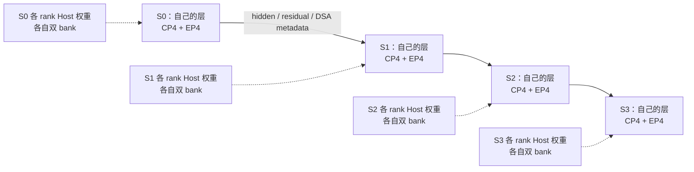

# 单机 A3 Prefill 权重卸载：PP4 / TP4 / DP1 / CP4 / stage 内 EP4

状态：首期代码与启动入口已实现，已完成 CPU 契约验证，待 A3 真机数值/通信/性能验收。代码基线：`879cc55995` 加本次工作区改动；更新日期：2026-11-08。

本稿按最新决策采用 **stage 内 EP**，替代此前跨 stage 的共享 EP16 方案。目标是在一台 A3（8 卡 / 16 die）运行一个 Prefill 实例：`PP4 × TP4`、Attention DP1、Attention CP4、EP4；只卸载 P 侧 routed experts。**当前只验收 P 单独运行、每请求输出 1 个 token**；真实 D / Router 联调留到后续，接入时 D 侧保持常驻。

## 1. 设计结论与范围

复用现有 PP 模型、stage 内 EP 通信和 `PrefillOnlyExecution`。每个 rank 只在 Host 保存“本 PP stage 的 routed 层 × 本 EP rank 的专家”，HBM 保留两个完整本地专家层的 bank，继续按本 stage 层序预取。

主要改动集中在三处：**按执行模式验证拓扑、按 PP 范围构建专家目录、正确表达 CP 局部有效行**。不增加全局专家服务、跨 stage 专家 communicator、任务排序器或 MoE 代理模块。默认混部与现有 PP1 的 P-only 行为保留。

V1 验收范围为 GLM-5.2 / ModelSlim W8A8、单机、全部本 stage 主模型 routed 层卸载、零 Hot / 无 LFU、eager、CP zigzag；关闭 MTP、EPLB、冗余专家、TBO/SBO、CP-TP group sharing 与新增 KV sharding。W4A8 和其他模型须另行验收。

当前请求使用 `max_new_tokens=1`、关闭 MTP；首 token 由最终 prefill 的 logits 采样产生 [C26]，无需再执行一次自回归 decode forward。长输入仍可能执行多个 prefill chunk，不能将“输出 1”理解为“只执行一次 forward”。首期不适配 PP/CP 下的 decode mask、MC2 decode、Hot/LFU、decode graph 或 D 侧执行；保留原 mixed 路径的既有回归边界。

stage 首层提前预热作为后续局部优化；V1 先沿用 `forward_scope()` 的起止边界，确保不会引入多个在途 forward 争用 bank。

## 2. 并行拓扑与权重归属

原生拓扑关系来自 [C01]：

```text
WORLD = PP × stage TP = 4 × 4 = 16
Attention TP = stage TP / Attention DP / Attention CP = 4 / 1 / 4 = 1
stage TP = EP × MoE TP × MoE DP = 4 × 1 × 1
```

这里 `--tp-size 4` 表示 stage 组宽；Attention 实际采用 CP4 / TP1。`--ep-size 4` 就是真实执行的 EP 宽度，没有第二套 pool EP。

| PP stage | WORLD ranks | stage TP / CP / EP 参与者 | 每 rank 专家归属（每层 256 专家） |
| --- | --- | --- | --- |
| S0 | 0–3 | 0,1,2,3 | EP rank 0–3 分别拥有 0–63、64–127、128–191、192–255 |
| S1 | 4–7 | 4,5,6,7 | 相同 EP 分片规则，作用于 S1 的层 |
| S2 | 8–11 | 8,9,10,11 | 相同 EP 分片规则，作用于 S2 的层 |
| S3 | 12–15 | 12,13,14,15 | 相同 EP 分片规则，作用于 S3 的层 |

TP、CP、EP 的成员集合在本配置下相同，继续使用各自原生 group 对象，不手工替换 communicator。PP 通道为 `[0,4,8,12]` 等四条通道；建组逻辑见 [C02]。EP rank 在每个 stage 内重新从 0 编号，不能用 WORLD rank 计算专家范围。



PP 切层，EP 切每层专家，CP 切 Attention 的 token 行。四个 stage 各拥有其层的全部专家；一个 rank 只拥有其中的 1/4。

## 3. 适配前的缺口与本次实现

官方 GLM-5.2 最佳实践给出了单个 P 实例的 PP4 / TP4 / CP4 配方，采用 W4A8 和 DeepEP；本稿沿用其并行布局，使用当前 offload 已接入的 Ascend Ops / W8A8 路径。官方结果不能直接作为本稿的性能结果。[官方最佳实践](https://docs.sglang.io/docs/hardware-platforms/ascend-npus/model-deployment/best-practices/glm_5_2)

| 内容 | 基线代码（适配前） | 本次处理 |
| --- | --- | --- |
| PP 层构建 | GLM DSA 复用 DeepSeekV2 的 `make_pp_layers()` | 保留真实 FusedMoE 模块，见 [C03] |
| PP 层范围 | `get_pp_indices()` 支持 `SGLANG_PP_LAYER_PARTITION` | offloader 与模型调用同一算法，见 [C04] |
| PP checkpoint 过滤 | loader 跳过本 stage 以外的层 | 原样保留，见 [C05] |
| Ascend Ops EP 宽度 | `_a2a_ep_size()` 将 EP 设为 stage TP | TP4 / EP4 与原逻辑一致，见 [C06] |
| offloader 拓扑校验 | 构造函数在解析 mode 前拒绝 PP>1 | 将 PP 约束交给执行模式，见 [C07] |
| 专家目录 | 枚举全模型 routed 层 | 增加可选 PP 范围过滤，见 [C08] |
| P-only CP 校验 | `PrefillOnlyExecution.configure()` 要求 CP1 | 在限定配置内开放 zigzag CP4，见 [C09] |
| CP 有效行 | Zigzag 继承返回 batch 计数的默认方法 | 使用逻辑局部行数，区分物理 padding，见 [C10]–[C13] |
| 双 bank 预取 | 固定卸载层序、全层搬运、W13/W2 分别等待 | 保留算法，输入改成本 stage 目录，见 [C14] |
| PP 调度及 PD 传输 | 已有 stage 内执行与按层 KV 传输 | 首期验证 PP + fake sender 的请求闭环；真实 PD KV 联调后移，见 [C15]、[C16]、[C25]–[C28] |

## 4. 最小扩展：模式策略 + 层范围

### 4.1 配置解析与校验顺序

继续使用 `CachedExecution` / `PrefillOnlyExecution` 两种策略，不再增加一套 PP offloader。

建议初始化顺序：

```text
解析 AscendOffloadOptions，确定 mixed / prefill_only
  → 公共校验：单机、Ascend Ops、TP=EP、MoE TP=1、MoE DP=1
  → 执行模式校验：PP/CP、图、batch overlap、模型范围
  → 解析本 stage 层范围
  → 构建本 stage 专家目录
  → 按目录准备 Host storage 和双 bank
```

实现使用各策略的 `validate_topology(...)`，并以 `validate_quantization(...)` 限定新增 PP 路径的 W8A8 格式。构造函数的 PP1 检查移入 mixed 策略；mixed 继续拒绝 PP>1 和 CP>1。已有 PP1 / CP1 P-only 配置保持支持。

P-only 新增支持：GLM-5.2 的 PP4 / EP4；CP>1 首期限定 DP1 / CP4 / Attention TP1 / zigzag。PP4 / CP1 作为中间验证配置。其他组合明确拒绝或另行资格验证，不因移除一个 assert 自动宣称支持。保留无图、无 TBO/SBO、trivial expert placement 等原约束。新增 PP 路径拒绝 `--disable-attn-tp-gather`，因为该选项会绕过安装 `is_extend_in_batch` 所需的 scheduler 同步。

### 4.2 stage 层范围与全局 layer ID

实现用不可变的 `(start_layer, end_layer)` 元组表达层归属，不持有通信、权重或调度状态。`AscendOpsOffloader._stage_layer_range()` 复用模型的分层算法，并提前拒绝空/负长度/不连续的 partition。

已实现的目录接口（`layer_range=None` 保留原有调用行为）：

```python
build_expert_catalog(
    hf_config,
    ep_size,
    ep_rank,
    offload_all_routed=True,
    layer_range=(start_layer, end_layer),
)
```

规则：

1. 仍按全模型配置判断 routed 层：GLM 的 `first_k_dense_replace`、`moe_layer_freq`。
2. 再取与 `[start_layer, end_layer)` 的交集，不把 stage 第一个 MoE 层重新当作 dense 或常驻层。
3. 保存原全局 `layer_id`；只有目录 key 偏移和预取序号在本进程内紧凑排列。`ExpertCatalog` 已支持这种形式，见 [C17]。
4. 参数默认 `None` 表示完整模型，保持旧调用兼容。混部的 resident prefix 选择保持原语义。
5. V1 要求每个 stage 至少包含一个 routed 层；不满足时在 Host 分配前清楚报错。空目录的 no-op offloader 不纳入首期。
6. 使用与模型相同的 `get_pp_indices()`、同一 partition 环境值；启动时校验构建出的本地 FusedMoE IDs 与目录完全一致。

例如按 0-based 全局层号、78 层、前 3 层 dense、`moe_layer_freq=1`、partition=`18,20,24,16`：

| stage | 模型层区间 | 卸载层区间 | routed 层数 |
| --- | --- | --- | --- |
| S0 | [0,18) | [3,18) | 15 |
| S1 | [18,38) | [18,38) | 20 |
| S2 | [38,62) | [38,62) | 24 |
| S3 | [62,78) | [62,78) | 16 |

以上分层沿用官方示例，适合做起始对照；W8 offload 的最佳分层还需测量。

## 5. 权重加载：保留现有模型与后处理链

保留 `DeepseekV2MoE.experts`、原 ModelSlim scheme/kernel、真实 FusedMoE 的 RunnerConfig 和 dispatcher。每 rank 每层为 64 个专家，MoE TP1，不构造专家代理或远端层 handle。

现有顺序继续成立：

```text
make_pp_layers：仅构建本 stage 层
  → ModelSlim.create_weights：offloader.prepare_layer 拦截 routed 参数
  → ExpertLayerStorage：为本 rank 的专家建立 Host 参数和 loader
  → 原 checkpoint loader：PP 过滤 + expert_id 过滤
  → 原量化 post-load：storage.finalize / NZ repack / INT8 dispatcher 绑定
  → offloader.post_init：校验本 stage storage 全部 sealed，分配双 bank
  → KV pool 预算与分配
```

`ExpertLayerStorage` 和 ModelSlim 后处理见 [C18]、[C19]；ModelRunner 中 offloader 安装与 `post_init()` 见 [C20]。仅过滤目录即可使计划中的层与模型真实拥有的层对齐，无需拆 checkpoint 流。

一个进程仍只拥有一个 MemFabric LOCAL Host pool [C21]。容量按本 stage 目录计算。Host master 仍不可变，格式转换仍有界；不得在通用 post-load 中将整个 Host master 再 staging 到 NPU。双 bank 应在现有 `post_init()` 时完成分配，以便后续 KV 预算看到真实占用。

## 6. CP 行布局与 MoE：保持原通信结构

### 6.1 三种行数必须区分

| 行数 | 用途 |
| --- | --- |
| 当前 CP rank 的逻辑有效行 | TopK padding 权重置零、正确性检查、有效吞吐统计 |
| 当前 CP rank 的物理输入行 | 含 padding 的模型、dispatch 与 combine 形状 |
| AllToAllV 后各本地专家的接收行 | GMM 计数，可能包含其他 CP rank 发来的路由和 padding 路由 |

CP 活跃时，逻辑有效行优先取 `metadata.per_rank_logical_token[cp_rank]`；尚未物理对齐的 metadata 才回退到 `per_rank_actual_token[cp_rank]`。不要使用原始 batch 总行数，也不要用总数直接除以 CP。

完整调用链是 `prepare_cp_forward()` → `build_metadata()` → `pad_logical_token_to_physical()` [C11]、[C12]。后者把 logical 列表保存下来，并重写 actual/physical 列表。CP4 的 zigzag 物理对齐单位是 `2×CP=8`。

```text
9 个有效 token、CP4：
logical rows  = [3, 2, 2, 2]
physical rows = [8, 8, 8, 8]   # 完整 prepare_cp_forward 路径之后
rank 1 mask  = [1, 1, 0, 0, 0, 0, 0, 0]
```

此前 review 的“各 rank 最终 padding 到 3 行”仅按 metadata 中间最大值推断，遗漏了后续 8 对齐；本稿以完整调用链为准。

### 6.2 用已有 CP strategy 接口完成适配

在 Zigzag 策略中实现局部有效行 accessor；CP metadata 准备时可一次性建立 int32 设备标量，供 `ForwardBatch.moe_num_token_non_padded()` 调用。不要在 offloader 每一层重复推导，也不要修改混部 Decode mask。现有调用入口见 [C10]、[C13]。

V1 保持基线的物理 padding 布局：NPU TopK 对无效行的权重置零，但保留合法 expert ID；dispatcher 仍按物理路由行数统计和交换。这与 [C22]、[C23] 的现有实现相符。**不新增 token 裁剪/压缩，不用逻辑有效行数替换 AllToAllV 的 split sizes 或 GMM 接收计数。** combine 保持原物理形状，后续 CP 边界按基线逻辑恢复行序、去除 padding。

零权重 padding 路由仍占通信和计算开销；性能统计与接收 workspace 预算必须计入。以后如需消除这些路由，应单独设计 pack/unpack 索引映射。

### 6.3 短输入、空输入与阶段一致性

zigzag 的 `can_apply()` 要求各 extend 长度足够，CP4 时短于 8 的输入可能回退 [C10]。回退时清除旧 CP metadata，使用普通 batch 行数；按现有布局，每个 CP rank 可持有完整输入。V1 保留这种复制执行，不能继续按 CP shard 截取，或临时只允许一个 rank dispatch 而不恢复其余 rank 的结果。

同一 stage 的四个 rank 必须按相同层序进入 collective。源侧零行、零接收和非零 peer 工作分别回归；量化模式下空 payload 的 dtype/scale 必须满足同一通信轮次契约。当前 dispatcher 是否交换 scale 取决于其是否为 None，若增加空输入快路径，必须保持各 rank 一致，不得跳过对应交换 [C23]。

本方案的各 rank 都执行自己 stage 的 forward，原 batch phase 仍有效，不需要独立专家任务 context，也不让空闲的其他 PP stage 代算当前层。

## 7. 双 bank 逐层预取与 PP 边界

### 7.1 首期原样保留固定序列算法

`LayerPrefetchPipeline.layer_ids` 改为本 stage 的有序卸载层列表，算法继续复用 [C14]：

| 时刻 | 操作 |
| --- | --- |
| 本 stage forward 入口 | 提交 E0 → bank A、E1 → bank B |
| E0 combine 完成 | bank A 可复用，搬 E2，与 E1 计算重叠 |
| E1 combine 完成 | bank B 可复用，搬 E3，与 E2 计算重叠 |
| stage forward 结束 | 等待已提交写入及读者完成，清理 context，reset pipeline |

E0/E1 是本 stage 卸载序列中的序号，独立于全局层号。准确的预取深度是**双 bank、稳定态预取下一待执行卸载层**；`retire(i)` 的 `i+2` 不表示拥有两个完整后续层的计算时间。

同一 copy stream 上按 W13、W2 顺序排队；GMM1 等 W13，GMM2 再等 W2，保留层内重叠。每个 microbatch / chunk 都重新进入上述生命周期，V1 不缓存上一 microbatch 的层权重或提前执行下一 microbatch。

### 7.2 固定层序下保留 copy plan 的 bank 绑定

现有 `AscendPrefillWeights` 在初始化时，按**目录内 index % 2**固定每层 plan 的物理目标地址；不是按 global layer_id % 2。只要每次 forward 从同一本地序列起点开始，plan 与 acquire 的 bank 就一致，可以保留。

第一个卸载层的全局 ID 为 3、18、38 或 62 时，都必须作为其目录的 index 0 使用 bank A。加入回归验证这一点。若未来改变任务顺序或跨 microbatch 轮换 bank，必须改成 `(layer_id, bank_id)` 绑定，不能靠向 `materialize_into()` 传另一个 bank 重定向旧 plan；此次 V1 不改变顺序。

### 7.3 PP 首层预热属于后续优化

当前 PP 循环先 `_pp_recv_proxy_tensors()`，再 `_pp_launch_batch()`；`forward_scope()` 内才调用 `begin_forward()`，见 [C15]、[C20]。因此机械沿用这条路径时，下游 stage 的首层 H2D 不能利用整个等待上游的时间。

V1 接受此启动开销，保留现有 PP 请求、广播及收包顺序。没有跨 stage 专家 collective 后，这些基线等待不需要改造成全机 progress engine。

若 profile 证明首层等待显著，可增加**本 stage 的权重预热预约**：在本地确认该 microbatch、所有 EP rank 的批次顺序一致且旧 bank 已退休后，提前提交首两层；forward 入口接管同一预约而不重复 `begin_forward()`。要求带 invocation 身份、取消排空、与旧 compute event 的依赖、至多一个 bank owner。优化不得依赖上一层激活已经算完，但也不能覆盖上一 microbatch 尚在读取的 bank。没有确认执行的 batch 时不得启动未约束的预热。

## 8. 首期 P 独立运行与后续 PD 联调

首期使用现有 P 服务和请求级 `FakeKVSender`，不部署 D / Router，不修改生产调度循环。请求直发 P 的 `/generate`，携带 `bootstrap_host=FAKE_BOOTSTRAP_HOST`（当前常量为 `2.2.2.2`）及 `bootstrap_room` [C25]、[C28]。这是代码识别的测试标记，不是真实 D 地址。

```text
请求 → 原 PP bootstrap 共识（fake sender 立即就绪）
     → PP4 / CP4 / EP4 完整 prefill（可包含多个 chunk）
     → 最后 stage 的 logits / 首 token 采样与 PP 结果回传
     → fake KV send / success → 原请求释放流程 → 返回 1 token
```

Fake sender 的 `poll_pp_consensus()` 复用 `poll()`，首次 `send()` 后报告成功；它不传输真实 KV，也不执行 D 模型 [C27]。P 仍会生成和管理本地 KV，并经过 bootstrap、完成通知、PP 释放共识等代码。因此，**无需适配 decode 计算，但不能跳过 P 自身的请求收尾与资源释放**。仅设置 `max_new_tokens=1` 不会把普通 PD 请求自动变成 fake 请求；未带测试标记时，正常 PD 协议仍可能等待真实对端。

首期必须保留：

- 继续运行 `event_loop_pp_disagg_prefill()`；每个 stage 只调用本地专家，允许不同 stage 处理不同 microbatch，不要求 16 rank 同时运行同一 MoE 层。
- 保留 `forward_scope()` 的同步收尾作为首期正确性边界；它可能影响吞吐，但避免异步计算结束前重用 bank。PP microbatch 队列不等于本 rank 可以同时拥有多个 offload forward。
- `_check_error()` 继续在**本 stage 的 EP4 组**归并错误 [C24]。不要改成 WORLD all-reduce；不同 stage 的层数和 forward 时刻不同，不能在任意层尾增加全机 barrier。
- stage 错误向现有 scheduler/进程监督路径上抛，取消/通信失败需确保整 P 实例不会继续发布部分结果；保持引用直到已提交 DMA 与读者完成。PP 对端退出后的超时和整实例收敛必须真机验证。
- P 端关闭 MTP，保留最终 logits、采样与 PP 结果回传，检查每个请求实际输出恰好 1 个 token。
- `PrefillOnlyExecution.prepare_decode_weights()` 继续拒绝 decode；不为输出首 token 添加 decode 兼容分支 [C09]。

后续接入真实 D / Router 时再验收（不作为当前 P-only 输出 1 的完成门槛）：

- KV 继续由原 StageModel 按本 stage 的层注册与传输。P PP4 → D PP1 使用现有映射和 Ascend 指针切片 [C16]；专家卸载不改变 bootstrap rank、KV 格式或 KV 层号。
- CP zigzag 按现有路径重建 KV；是否由全部 CP rank 传输服从原 PD 设置，不能仅凭 CP4 推断 KV 是四份互不重叠的分片。不启用新增 DSA KV layer split。
- 真实 KV 完整性、D 继续生成、Router 返回、跨节点取消和故障收敛另做联调。若既有 D 启用 MTP，还需另行确认 target/draft KV 协议兼容。

Fake sender 测试只证明 P 计算与本地请求生命周期；不能据此宣称真实 P→D KV 传输已通过。

## 9. 参数草案与资源预算

以下参数已接入新增的 `serve_glm52_prefill_pp4_cp4.sh`；模型路径、容量和环境变量配置见同目录 `README_PREFILL_PP4_CP4.md`。先执行 `--dry-run` 检查模型配置与命令，再在 A3 上启动。dry-run 和 CPU 测试通过不等于真机部署已通过。

```bash
export SGLANG_PP_LAYER_PARTITION=18,20,24,16

# 合并进 P 侧启动参数；模型及服务参数另行提供。
--nnodes 1
--pp-size 4
--tp-size 4
--dp-size 1
--attn-dp-size 1
--enable-prefill-cp
--attn-cp-size 4
--cp-strategy zigzag
--ep-size 4
--moe-dp-size 1
--moe-dense-tp-size 1
--moe-a2a-backend ascend_ops
--disaggregation-mode prefill
--disaggregation-transfer-backend ascend
--disable-overlap-schedule
--cuda-graph-backend-prefill disabled
--cuda-graph-backend-decode disabled
--disable-shared-experts-fusion
--moe-offload-config /path/to/prefill_stage_ep4.json
```

目标配置只使用原生 EP 和已有 offload mode，不新增执行模式 CLI。`execution_slots` 示例：

```json
{
  "mode": "prefill_only",
  "cache_ratio": 0,
  "execution_slots": 128,
  "host_pool_gib": 64
}
```

`128 = 2 × (256 / 4)`。实际专家数从 checkpoint 读取；也可省略 execution_slots，沿用 P-only 的 `2 × local_experts` 默认值。native ACL 扩展仍按现有部署方式加载；如不在 Python 搜索路径中，使用已有 `native_extension_directory` 配置。

首期独立 P 请求示例（完成 PP/CP offload 适配后使用；将地址和端口换成 P HTTP 服务）：

```bash
curl -sS 'http://<P_IP>:<P_PORT>/generate' \
  -H 'Content-Type: application/json' \
  -d '{
    "text": "请解释流水线并行、上下文并行和专家并行如何共同完成长文本的预填充计算。",
    "sampling_params": {"temperature": 0, "max_new_tokens": 1, "ignore_eos": true},
    "bootstrap_host": "2.2.2.2",
    "bootstrap_room": 0,
    "stream": false
  }'
```

这里的 `2.2.2.2` 必须与代码中的测试常量一致，不替换成 D IP；`bootstrap_room=0` 复用已有 benchmark 的 fake 请求约定。验收比较 token ID / logits，不能只看可见文本长度：单个生成 token 可能是空白或特殊 token。性能测试需使用目标输入长度；极短输入可能触发 CP 回退，不能用它证明 CP4 已生效。

启动参数继续保留 `--disaggregation-mode prefill`，因为 offload 的 `prefill_only` 模式要求该上下文。两项 graph backend 都设为 disabled 是现有模式校验要求 [C09]，不表示本轮会运行 decode。无需为独立 P 测试改成 mixed 模式或新增测试执行模式。

预算示例沿用旧设计中的 H=6144、I=2048、E=256、78 层、前 3 层 dense、W8 权重本体假设，**尚未读取实际 checkpoint 证明这些数值**：

```text
单专家 = 3 × H × I × 1 byte = 36 MiB
每 rank 每层 = 64 × 36 MiB = 2.25 GiB
每 rank 双 bank = 4.5 GiB
```

| stage | routed 层数 | Host 权重本体 / rank | stage 内 4 rank 合计 |
| --- | --- | --- | --- |
| S0 | 15 | 33.75 GiB | 135 GiB |
| S1 | 20 | 45 GiB | 180 GiB |
| S2 | 24 | 54 GiB | 216 GiB |
| S3 | 16 | 36 GiB | 144 GiB |
| 整机 | 75 | 按 stage 不同 | 675 GiB |

以上不含 scale/offset、对齐、转换暂存、checkpoint 页缓存。旧 EP16 示例中的 `host_pool_gib=48` 不能照搬：S2 单权重本体就需要 54 GiB/rank。统一配置 64 GiB/rank 的物理 Host pool 合计 **1024 GiB**，还要留系统及加载余量；这是待预检的容量示例，不是硬件可容纳的保证。`prepare_layer()` 应继续按实际 format.host_nbytes 与本 stage 目录做预算检查。

HBM 另计 Attention/dense/shared、KV、接收激活、通信和 GMM workspace。预算按最忙 rank、物理 padding 及路由倾斜核算，不能只用均匀路由平均值。不同 stage 的层数也影响 KV 容量，沿用已有 KV allocator 的容量协调。

## 10. 是否还能掩盖权重搬运

stage 内 EP4 相比原单 stage EP16，每 rank 每层搬运专家从 16 个增为 64 个，单层搬运量为 4 倍；相同 token 总量、均匀路由时每 rank 的专家计算量也约为 4 倍。PP 减少每 rank 负责的层数，不能据此把单层权重再除以 PP4。

CP4 不减少每层专家权重字节数。专家计算按 AllToAllV 后接收的行数决定，不能在 `token×topk/EP4` 的基础上再除以 CP4；短输入回退和 padding 还会增加物理路由行。Attention TP 从 stage TP4 分解为 CP4 / TP1 后，Attention 时间也不能简单按四分之一估计。

每次完整模型 pass / chunk 若所有 routed 层均全量搬运，整机仍约 675 GiB 权重本体；多个 microbatch/chunk 会重复搬运。四个 stage 同时预取会竞争 Host 内存带宽及互连，不能用单 rank 独占拷贝带宽预测并发性能。

能否掩盖要分别看 W13/GMM1 与 W2/GMM2 的截止时间：bank 可复用之后，能用于重叠的窗口包括中间层的 Attention/MoE、目标层的 Attention/dispatch，以及层内 GMM1 与 W2 的重叠。实际窗口还受 copy stream 排队和资源竞争限制。更小的 microbatch/chunk 通常减少计算而不减少整层搬运，尤其容易暴露 H2D。

记录每 stage 的首层等待、W13/W2 wait、H2D 并发带宽、PP bubble、P tokens/s、TTFT 和 Host/HBM 峰值。优先与相同 PP4/CP4/EP4 的常驻 Ascend Ops 路径比较数值与卸载开销；官方 DeepEP 常驻配方可作为另外一项系统基线，但要区分后端和精度差异。

## 11. 适配清单与实施顺序

| 优先级 | 代码位置 | 具体工作 |
| --- | --- | --- |
| P0 | [C07]、[C09]、`options.py` | 先解析 mode；分模式校验 PP/CP，保留旧混部边界 |
| P0 | [C08]、[C04]、[C17] | stage 范围过滤、保留全局 layer ID、空目录与 partition 预检 |
| P0 | [C07] prepare_layer/post_init、[C18]–[C20] | 校验目录与真实模块一致，保留 Host 拦截和量化后处理链，容量按 EP4/本 stage 核算 |
| P0 | [C10]–[C13] | Zigzag 的局部逻辑有效行 accessor；CP 活跃/回退切换不使用旧 metadata |
| P0 | [C14] | 复用固定层序；验证本地 index 与 bank 绑定、不同 chunk/microbatch 生命周期 |
| P0 回归 | [C22]、[C23]、Ascend runner | padding 权重零化、物理 counts 一致、返回形状及零输入通信契约；仅在测试发现缺口时局部修改 |
| P1 回归 | [C15]、[C24]–[C28] | PP 推进、首 token 返回、fake sender 完成、错误收敛、取消和资源释放；不引入跨 stage 专家同步 |
| 后续 PD 联调 | [C16] | 真实 P→D KV 全层覆盖、D 继续生成与 Router；不阻塞首期验收 |
| P1 | 启动参数与日志 | 独立验证此拓扑，打印 pp_rank、layer_range、EP rank、Host bytes、bank bytes；新增独立脚本，保留原 PD 启动入口 |
| P2 | [C15] 与 [C09] 的预取入口 | 有 profile 证据后增加 stage 首层预热预约，保留现有路径作回退 |

实施阶段：

1. **CPU 契约**：拓扑拒绝/接受矩阵、四 stage 目录、专家覆盖、内存计算及生命周期测试。
2. **PP4 / CP1 / EP4**：小模型或目标模型先验证 PP 层归属和双 bank；不同时引入 CP 改动。
3. **PP4 / CP4 / EP4、输出 1**：通过第 9 节 fake 请求直连 P；与同拓扑常驻结果比较，验证 CP 输入、PP proxy、DSA metadata、最终 logits / 首 token、正常完成和资源释放。
4. **Prefill 性能**：测量目标输入长度、batch / chunk 配置下的 P 吞吐、首 token 时延和权重等待；再决定是否实现 stage 首层预热。本轮不测 decode 吞吐 / TBT。

以上为当前验收闭环。之后如需完整 PD 部署，再增加 **真实 D / Router 联调**：bootstrap、四 stage KV 到 D PP1、多 token 输出、取消与失败释放。

不接 D 的首选方式是复用已有 fake sender 请求入口，无需新建 KV peer 服务。更细粒度的数值测试可直接驱动 ModelRunner/模型，但必须保留 prefill-only 运行上下文；不能因为只输出 1 个 token 就切换到 mixed offloader。

必须覆盖：

- 四 stage 卸载层集合互不重叠且并集为全部 routed 层；同一 stage 四 rank 专家覆盖完整；跨 stage 不错误装载同一层。
- 全局起始 layer ID 为奇数、非零，或 `moe_layer_freq>1` 时仍按本地卸载序号交替 bank；不影响旧 resident prefix。
- 9 token 的 CP4 logical `[3,2,2,2]` / physical `[8,8,8,8]`；多请求、不等长、prefix hit、chunk 尾部和 CP 开关回退；有效输出与参考一致。
- padding 权重为零但 split sizes 仍与实际 payload 一致；零收包 rank 不遗漏 collective；正确性覆盖极端路由倾斜。
- 同一 stage 连续两个 microbatch、部分预取失败、取消、W13 完成而 W2 未完成、combine 前不复用 bank。
- stage 层数不同、S0 先运行 dense 层、S2 延迟、一个 stage 出错时其他 stage 不永久悬挂。
- 请求输出恰好 1 token；profile / forward mode 记录中不出现本请求的 decode 计算。长输入多个 chunk、连续请求和批请求仍须正确完成，末尾 KV / metadata / bank 引用可释放或按既有 cache 规则回收。
- mixed PP1/CP1、旧 P-only PP1/CP1 保持行为兼容；若修改了共用入口，运行已有 Attention TP Decode mask 回归即可，不新增 PP4/CP4 decode 适配或多 token 生成验收。

现有测试落点为 `test/registered/unit/offloading/test_ascend_glm_offload.py`、`test_ascend_prefill_only.py`、`test_ascend_prefill.py` 和 `test_ascend_decode_mask.py`；CP 元数据契约另在对应 CP 测试中覆盖。本轮验证结果见下文；仍需在完整 Ascend 环境运行常规测试入口和真机用例。

本轮实现和验证：

- 生产修改仅涉及 offloader 构造、两个执行策略、目录过滤和 Zigzag MoE 有效行 accessor；`prefill.py` 的双 bank 预取、原 PP scheduler 与 dispatcher 通信流程复用原实现。
- 新增 `serve_glm52_prefill_pp4_cp4.sh` 和使用说明；脚本自动生成 offload JSON，继承当前 Python 环境，单机通信不依赖 `ip` 等工具；DP1 配置省略仅适用于 Attention DP>1 的 `--enable-dp-lm-head`。
- 已通过：54 项 offload/目录/配置 CPU 契约测试、5 项 Zigzag 有效行测试、4 项 launcher 测试，以及 shell/Python 语法和 diff 检查。offload/CP 测试在本机通过隔离导入执行生产定义；设备、进程组及 stream/event 边界使用 CPU 替身。
- 本机完整测试入口因缺少 `orjson`、`transformers` / Ascend 依赖而不能加载；未执行 NPU GMM、HCCL/PP 通信、真实 P→D KV、A3 首 token 数值或吞吐验证。权重搬运能否被掩盖需要按第 10 节实际测量。

## 12. 代码定位索引

以下链接定位本次工作区的入口；未修改的代码保持基线 `879cc55995` 的位置。

| 编号 | 入口 | 用途 |
| --- | --- | --- |
| [C01] | runtime_context.py:137 | 并行宽度推导 |
| [C02] | parallel_state.py:2908 | stage 内 EP 与 PP 建组 |
| [C03] | deepseek_v2.py:2978 | PP 层构建及真实 FusedMoE |
| [C04] | distributed/utils.py:110 | PP 层区间与自定义 partition |
| [C05] | deepseek_weight_loader.py:335 | 原 PP checkpoint 过滤 |
| [C06] | arg_groups/overrides.py:1653 | Ascend Ops EP 与 stage TP 对齐 |
| [C07] | offloading/moe/npu/ascend_ops.py:77 | offloader 构造、目录与资源校验 |
| [C08] | offloading/moe/npu/model_adapter.py:22 | 专家目录构建 |
| [C09] | offloading/moe/npu/execution_mode.py:82 | P-only 校验、双 bank 与 forward 生命周期 |
| [C10] | cp/zigzag.py:106 | CP 激活条件及 metadata；默认 accessor 在 cp/base.py:115 |
| [C11] | cp/utils.py:270 | 完整 CP metadata 准备与 padding 调用 |
| [C12] | cp/padding.py:24 | CP 对齐与 logical/physical 区分 |
| [C13] | forward_batch_info.py:1419 | MoE 有效行 accessor 调用 |
| [C14] | offloading/moe/npu/prefill.py:61 | 固定层序双 bank；plan 构建在同文件 168 |
| [C15] | scheduler_pp_mixin.py:217 | PP Prefill 循环；299 收 proxy、312 launch |
| [C16] | disaggregation/ascend/conn.py:234 | PP KV 指针切片；公共 PP/CP 映射在 common/conn.py:1492 |
| [C17] | offloading/moe/config.py:84 | 全局 layer ID 与本地紧凑 key |
| [C18] | offloading/moe/npu/format.py:334 | Host storage；447 finalize |
| [C19] | modelslim/modelslim.py:555 | finalize 与 INT8 dispatcher 绑定 |
| [C20] | model_runner.py:506 | 模型前安装 offloader；1380 post_init；1902 forward_scope |
| [C21] | offloading/moe/npu/storage.py:89 | MemFabric LOCAL pool 所有权 |
| [C22] | hardware_backend/npu/moe/topk.py:125 | 保留合法 ID、无效行权重置零 |
| [C23] | token_dispatcher/ascend_ops.py:545 | 物理路由 counts / payload / scale / combine |
| [C24] | offloading/moe/npu/ascend_ops.py:727 | stage 内 EP 错误归并 |
| [C25] | disaggregation/prefill.py:403 | 按 FAKE_BOOTSTRAP_HOST 选择 fake sender；485 将 P 请求 max_new_tokens 设为 1 |
| [C26] | disaggregation/prefill.py:1057 | 接收 prefill 首 token；1276 完成后释放、1319 返回结果 |
| [C27] | disaggregation/fake/conn.py:40 | fake sender 的 bootstrap、PP poll 与完成状态 |
| [C28] | disaggregation/utils.py:50 | FAKE_BOOTSTRAP_HOST 常量；benchmark/one_batch_server.py:796 注入请求字段 |

[C01]: /Users/yaobao/Desktop/Workspace-Ascend/sglang-moe-offload-npu/源哥的优化分支/sglang-experiment-ascend-ops-moe-offload-review/python/sglang/srt/runtime_context.py:137
[C02]: /Users/yaobao/Desktop/Workspace-Ascend/sglang-moe-offload-npu/源哥的优化分支/sglang-experiment-ascend-ops-moe-offload-review/python/sglang/srt/distributed/parallel_state.py:2908
[C03]: /Users/yaobao/Desktop/Workspace-Ascend/sglang-moe-offload-npu/源哥的优化分支/sglang-experiment-ascend-ops-moe-offload-review/python/sglang/srt/models/deepseek_v2.py:2978
[C04]: /Users/yaobao/Desktop/Workspace-Ascend/sglang-moe-offload-npu/源哥的优化分支/sglang-experiment-ascend-ops-moe-offload-review/python/sglang/srt/distributed/utils.py:110
[C05]: /Users/yaobao/Desktop/Workspace-Ascend/sglang-moe-offload-npu/源哥的优化分支/sglang-experiment-ascend-ops-moe-offload-review/python/sglang/srt/models/deepseek_common/deepseek_weight_loader.py:335
[C06]: /Users/yaobao/Desktop/Workspace-Ascend/sglang-moe-offload-npu/源哥的优化分支/sglang-experiment-ascend-ops-moe-offload-review/python/sglang/srt/arg_groups/overrides.py:1653
[C07]: /Users/yaobao/Desktop/Workspace-Ascend/sglang-moe-offload-npu/源哥的优化分支/sglang-experiment-ascend-ops-moe-offload-review/python/sglang/srt/offloading/moe/npu/ascend_ops.py:77
[C08]: /Users/yaobao/Desktop/Workspace-Ascend/sglang-moe-offload-npu/源哥的优化分支/sglang-experiment-ascend-ops-moe-offload-review/python/sglang/srt/offloading/moe/npu/model_adapter.py:22
[C09]: /Users/yaobao/Desktop/Workspace-Ascend/sglang-moe-offload-npu/源哥的优化分支/sglang-experiment-ascend-ops-moe-offload-review/python/sglang/srt/offloading/moe/npu/execution_mode.py:82
[C10]: /Users/yaobao/Desktop/Workspace-Ascend/sglang-moe-offload-npu/源哥的优化分支/sglang-experiment-ascend-ops-moe-offload-review/python/sglang/srt/layers/cp/zigzag.py:106
[C11]: /Users/yaobao/Desktop/Workspace-Ascend/sglang-moe-offload-npu/源哥的优化分支/sglang-experiment-ascend-ops-moe-offload-review/python/sglang/srt/layers/cp/utils.py:270
[C12]: /Users/yaobao/Desktop/Workspace-Ascend/sglang-moe-offload-npu/源哥的优化分支/sglang-experiment-ascend-ops-moe-offload-review/python/sglang/srt/layers/cp/padding.py:24
[C13]: /Users/yaobao/Desktop/Workspace-Ascend/sglang-moe-offload-npu/源哥的优化分支/sglang-experiment-ascend-ops-moe-offload-review/python/sglang/srt/model_executor/forward_batch_info.py:1419
[C14]: /Users/yaobao/Desktop/Workspace-Ascend/sglang-moe-offload-npu/源哥的优化分支/sglang-experiment-ascend-ops-moe-offload-review/python/sglang/srt/offloading/moe/npu/prefill.py:61
[C15]: /Users/yaobao/Desktop/Workspace-Ascend/sglang-moe-offload-npu/源哥的优化分支/sglang-experiment-ascend-ops-moe-offload-review/python/sglang/srt/managers/scheduler_pp_mixin.py:217
[C16]: /Users/yaobao/Desktop/Workspace-Ascend/sglang-moe-offload-npu/源哥的优化分支/sglang-experiment-ascend-ops-moe-offload-review/python/sglang/srt/disaggregation/ascend/conn.py:234
[C17]: /Users/yaobao/Desktop/Workspace-Ascend/sglang-moe-offload-npu/源哥的优化分支/sglang-experiment-ascend-ops-moe-offload-review/python/sglang/srt/offloading/moe/config.py:84
[C18]: /Users/yaobao/Desktop/Workspace-Ascend/sglang-moe-offload-npu/源哥的优化分支/sglang-experiment-ascend-ops-moe-offload-review/python/sglang/srt/offloading/moe/npu/format.py:334
[C19]: /Users/yaobao/Desktop/Workspace-Ascend/sglang-moe-offload-npu/源哥的优化分支/sglang-experiment-ascend-ops-moe-offload-review/python/sglang/srt/layers/quantization/modelslim/modelslim.py:555
[C20]: /Users/yaobao/Desktop/Workspace-Ascend/sglang-moe-offload-npu/源哥的优化分支/sglang-experiment-ascend-ops-moe-offload-review/python/sglang/srt/model_executor/model_runner.py:506
[C21]: /Users/yaobao/Desktop/Workspace-Ascend/sglang-moe-offload-npu/源哥的优化分支/sglang-experiment-ascend-ops-moe-offload-review/python/sglang/srt/offloading/moe/npu/storage.py:89
[C22]: /Users/yaobao/Desktop/Workspace-Ascend/sglang-moe-offload-npu/源哥的优化分支/sglang-experiment-ascend-ops-moe-offload-review/python/sglang/srt/hardware_backend/npu/moe/topk.py:125
[C23]: /Users/yaobao/Desktop/Workspace-Ascend/sglang-moe-offload-npu/源哥的优化分支/sglang-experiment-ascend-ops-moe-offload-review/python/sglang/srt/layers/moe/token_dispatcher/ascend_ops.py:545
[C24]: /Users/yaobao/Desktop/Workspace-Ascend/sglang-moe-offload-npu/源哥的优化分支/sglang-experiment-ascend-ops-moe-offload-review/python/sglang/srt/offloading/moe/npu/ascend_ops.py:727
[C25]: /Users/yaobao/Desktop/Workspace-Ascend/sglang-moe-offload-npu/源哥的优化分支/sglang-experiment-ascend-ops-moe-offload-review/python/sglang/srt/disaggregation/prefill.py:403
[C26]: /Users/yaobao/Desktop/Workspace-Ascend/sglang-moe-offload-npu/源哥的优化分支/sglang-experiment-ascend-ops-moe-offload-review/python/sglang/srt/disaggregation/prefill.py:1057
[C27]: /Users/yaobao/Desktop/Workspace-Ascend/sglang-moe-offload-npu/源哥的优化分支/sglang-experiment-ascend-ops-moe-offload-review/python/sglang/srt/disaggregation/fake/conn.py:40
[C28]: /Users/yaobao/Desktop/Workspace-Ascend/sglang-moe-offload-npu/源哥的优化分支/sglang-experiment-ascend-ops-moe-offload-review/python/sglang/srt/disaggregation/utils.py:50
